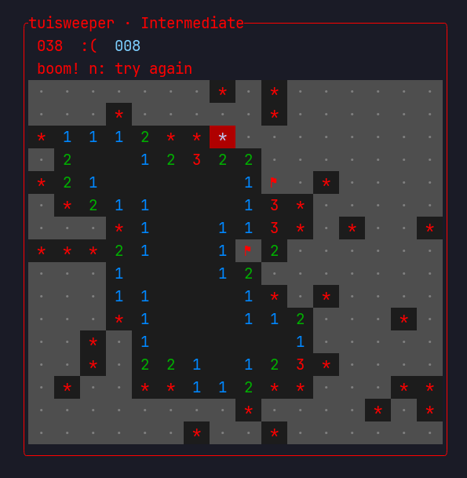

# tuisweeper

A single-player terminal Minesweeper clone built with [SpectreTuff](https://github.com/EluciusFTW/SpectreTuff)
(Spectre.Tui) and Elmish. Play it standalone, or embed it as a component in your own Elmish application
via the [`EluciusFTW.Tuisweeper`](https://www.nuget.org/packages/EluciusFTW.Tuisweeper) NuGet package
(see [Project structure](#project-structure)).



## Running / Installing

Requires the [.NET 10 SDK](https://dotnet.microsoft.com/download). You can run directly from source:

```sh
dotnet run --project src/Tuisweeper.Cli
```

Alternatively, use the included scripts to build a
single-file, framework-dependent executable and copy it onto your `PATH` as `tuisweeper`.

**Linux / macOS:**

```bash
./scripts/install.sh             # installs to ~/.local/bin (or $TUISWEEPER_INSTALL_DIR)
./scripts/install.sh /custom/dir # or a custom directory
```

**Windows (PowerShell):**

```powershell
scripts\install.ps1                      # installs to %LOCALAPPDATA%\Programs\tuisweeper
scripts\install.ps1 -InstallDir C:\tools # or a custom directory
```

If the chosen directory is not already on your `PATH`, the script prints how to add it.

| Key                    | Action                                                                         |
| ---------------------- | ------------------------------------------------------------------------------ |
| ←↑↓→ / `h` `j` `k` `l` | move cursor                                                                    |
| `Space` / `Enter`      | reveal; on a number with all its mines flagged, reveals the neighbours (chord) |
| `f`                    | toggle flag                                                                    |
| `n`                    | new game                                                                       |
| `1` `2` `3`            | Beginner (9×9, 10) · Intermediate (16×16, 40) · Expert (30×16, 99)             |
| `q` / `Esc`            | quit                                                                           |

The first reveal is always safe: mines are placed after it, away from the clicked cell.
Goal is to reveal all safe squares - mines do not have to be flagged.

Your best time per difficulty is shown while playing and saved to `~/.config/tuisweeper/highscores.txt`
(`%APPDATA%\tuisweeper\highscores.txt` on Windows).

## Project structure

The game is split into a library and a thin executable, so it can be embedded in other
SpectreTuff.Elmish apps (e.g. as a pop-up game in [tuigether](https://github.com/EluciusFTW/tuigether)):

| Project                | Output                                                       | Contents                                                                                                   |
| ---------------------- | ------------------------------------------------------------ | ---------------------------------------------------------------------------------------------------------- |
| `src/Tuisweeper.Core/` | `Tuisweeper.Core.dll`, NuGet package `EluciusFTW.Tuisweeper` | The game as an Elmish component (`init`, `update`, `view`, `subscriptions`), board logic, highscore stores |
| `src/Tuisweeper.Cli/`  | the `tuisweeper` executable                                  | `Program.fs` only: hosts the component full-screen                                                         |

The library's public surface is the `Tuisweeper` module, `Highscore.Store` and `Difficulty`; everything else is
internal. The component never ends the program or chooses where data lives on its own:

- **Dependencies** (`Tuisweeper.Dependencies`): the highscore store, random source and clock are passed in by
  the host. `Highscore.Store` provides `defaultFile` (the path above), `file path` and `none`, or bring your own
  `{ Load; Save }`.
- **Closing**: `update` returns `Some Closed` when the player presses `q`/`Esc`; the CLI exits on it, an
  embedding app might hide an overlay instead.
- **Keys**: the host owns the terminal and routes key presses in as `Tuisweeper.InputMsg`.

See the [package README](src/Tuisweeper.Core/README.md) for a hosting example.

### Publishing

Pushing changes under `src/Tuisweeper.Core/` (or `version.json`) to `main` publishes the library to NuGet via
[`.github/workflows/tuisweeper-publish.yml`](.github/workflows/tuisweeper-publish.yml). Versions come from
[Nerdbank.GitVersioning](https://github.com/dotnet/Nerdbank.GitVersioning): `version.json` sets major.minor,
the commit count the patch. To try the package locally before publishing:

```sh
dotnet pack src/Tuisweeper.Core -c Release -o ~/nuget-local
```

## License

[MIT](LICENSE.md)
